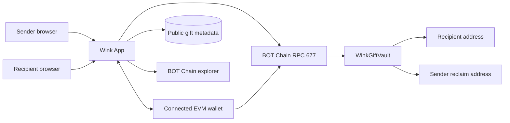
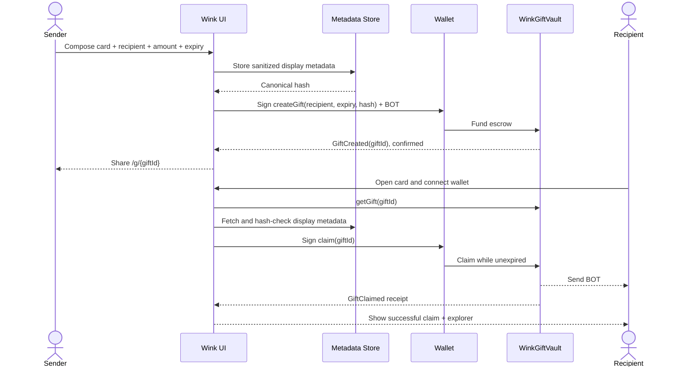

# Wink — System Architecture

**Version:** v1.0 · **Date:** 2026-11-10 · **Model:** independent consumer-facing gift vault + optional non-custodial display metadata service.

## 1. System overview

Wink has two independent data planes: an **on-chain financial plane** holding exact sender, recipient, amount, expiry and state, and a **presentation plane** containing optional public card text/styles. The contract never depends on the presentation plane to authorize transfers. This is essential for funds safety when the website or DB fails.



## 2. Trust boundaries and responsibilities

| Component | Responsibility | Must never do |
| --- | --- | --- |
| Gift composer | Recipient validation, message/style, preview, claim requirement education | Handle private keys; imply a link alone can claim |
| Wallet provider | User-approved create/claim/reclaim transactions | Sign silently or on behalf of another account |
| Gift vault contract | Escrow native BOT and enforce recipient/sender/expiry | Change authorized recipient; rely on API for withdrawal |
| Metadata store | Store public message/theme by content hash | Store hidden recipient secrets; override vault state |
| Chain read layer | Query gift by ID and decode final receipt/event | Convert pending tx into success based on optimistic UI |
| Explorer | Public, third-party readable receipts | Serve as the sole proof of a successful call without contract event cross-check |

## 3. Canonical entity model

```text
Gift
  giftId: uint256
  sender: address
  recipient: address
  amountWei: uint256
  expiresAt: uint64
  metadataHash: bytes32
  state: Funded | Claimed | Reclaimed

Optional GiftMetadata
  hash: bytes32 (key)
  v: 1
  style: small allowlisted theme ID
  note: <= 280 plain-text characters
  createdAt: server timestamp (noncanonical)
```

Metadata is *public*. Data minimization means no emails, phone numbers, real names by default or private greeting content. `giftId` is on-chain and can be enumerated; keep personal notes modest.

## 4. Transaction flows



**Recovery flow:** If and only if deadline passed and state still `Funded`, original sender calls `reclaim`; contract sets `Reclaimed` then transfers amount back, and the frontend shows the confirmed result.

## 5. Data consistency and resilience

- Chain read wins over cached gift state. UI invalidates read cache after successful transaction.
- If metadata fetch fails, the app shows "Gift message temporarily unavailable" but still renders on-chain recipient, amount and claim controls.
- If RPC fails, claiming must be visibly unavailable instead of guessing from local state; don't accept a gift ID as proof of funding.
- If browser is closed mid-transaction, the public link can reconstruct state solely from gift ID and contract read.
- If user is on wrong account, show recipient address and a safe switch-wallet explanation.

## 6. Frontend and service layout

```text
wink/
  app/{page.tsx,create/page.tsx,g/[giftId]/page.tsx,help/page.tsx}
  app/api/metadata/{route.ts,[hash]/route.ts}   # if DB chosen
  components/{gift-composer,reveal-card,claim-panel,reclaim-panel,transaction-status}
  lib/{chain.ts,vault.ts,metadata-hash.ts,validation.ts}
  contracts/src/WinkGiftVault.sol
  contracts/test/{WinkGiftVault.t.sol,WinkInvariants.t.sol}
  contracts/script/{Deploy.s.sol}
  docs/{PRD.md,TRD.md,architecture.md,projectplan.md}
```

Prefer a limited server-side DB for notes, not unbounded URL parameters. Metadata can be populated first and referred to by hash; orphaned unlinked metadata can be pruned. No central database operation is allowed to block claim execution once the contract has been funded.

## 7. Attack surfaces and operating policy

- Contract: expiration boundaries, state changes before external transfers, `nonReentrant`, strict role guards, no owner withdrawals.
- UI: recipient address spoofing, fake network, HTML injection in note, misleading free-gas copy.
- Metadata API: public rate-limited post, hash integrity verification, sanitization, basic spam removal for public content (without affecting custody).
- Monitoring: live site, canonical gift read, gift state transitions, server/API health and flagged failures. No surveillance of user identity or personal chats.

## 8. Architectural signoff checklist

- [ ] External sharing URL is **not** sufficient to claim; only nominated account signs and succeeds.
- [ ] All in-flight assets are contract-controlled and contract-sourced, never stored in API wallets.
- [ ] Expiry has a single unambiguous boundary; double spend impossible.
- [ ] If metadata service is down, on-chain claim/reclaim still work.
- [ ] Production contract and ABI are deployed to chain 677 and independently verified.

**Related:** [`PRD.md`](./PRD.md), [`TRD.md`](./TRD.md), [`projectplan.md`](./projectplan.md).
